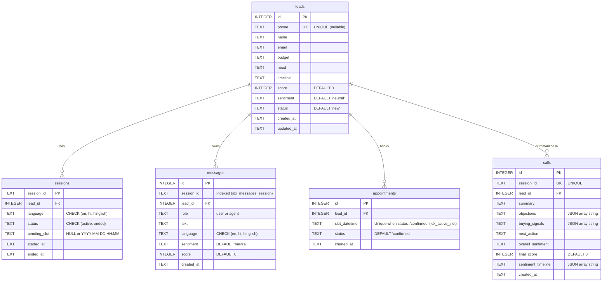

# Zenvo Codebase Walkthrough (For Python & FastAPI Developers)

This guide explains how **Zenvo** works from the moment you run `run.bat` to the moment a call finishes and appears on the CRM dashboard. Every module name, function name, SQL table, CSS variable, and code snippet matches the actual repository.

---

## 1. Application Startup (Execution Order)

1. **`run.bat` (Windows launcher)**
   - Runs `cd /d "%~dp0"` so relative paths work even when the project sits inside a folder with spaces.
   - Locates `python` (or `py -3`).
   - Checks for `.venv\Scripts\python.exe`. On first run only, creates `.venv`, upgrades `pip`, and installs `requirements.txt`.
   - Checks for `.env`. If missing, copies `.env.example` to `.env`, prints instructions to add `LLM_API_KEY`, pauses, and exits cleanly (`exit /b 0`) without starting the server with empty credentials.
   - Runs `".venv\Scripts\python.exe" -c "from app.db import init_db; init_db()"` so tables and indexes exist before traffic arrives (without deleting existing rows).
   - Launches `uvicorn app.main:app --host 127.0.0.1 --port 8000`.

2. **Environment Variables (`.env`)**
   - `load_dotenv()` runs in `app/main.py`, `app/brain.py`, and `app/seed.py`, loading `LLM_BASE_URL`, `LLM_API_KEY`, `LLM_MODEL`, optional `LLM_FALLBACK_*`, and `DB_PATH`.

3. **FastAPI Startup (`app/main.py`)**
   - `lifespan(app)` executes `db.init_db()` automatically when FastAPI boots (including under `TestClient(app)`).
   - `app.mount("/static", StaticFiles(directory=BASE_DIR / "static"), name="static")` serves `call.css`, `call.js`, and `dashboard.css`.
   - `templates = Jinja2Templates(directory=BASE_DIR / "templates")` serves `call.html`, `dashboard.html`, and `call_detail.html`.
   - `CORSMiddleware` restricts cross-origin browser access to `localhost` / `127.0.0.1`.

4. **Database Initialization (`app/db.py`)**
   - `init_db()` first calls `backup_legacy_db_if_needed()` (renaming any legacy DB lacking `sessions.started_at` to `zenvo.db.bak`), enables `PRAGMA journal_mode=WAL;`, and creates the five SQLite tables plus `idx_messages_session` and `idx_active_slot`.

---

## 2. Backend Modules (Execution-Flow Order)

### `app/main.py` — HTTP API, Request Validation & Call State Orchestrator
- **Why it exists**: Single entry point serving both HTML pages (`/`, `/dashboard`, `/dashboard/calls/{call_id}`) and JSON API endpoints (`/health`, `/api/slots`, `/start_call`, `/turn`, `/end_call`). Enforces server-side business rules so the LLM cannot directly write to the database or bypass booking rules.
- **Important symbols**: `lifespan`, `StartCallRequest`, `TurnRequest`, `EndCallRequest`, `build_greeting`, `classify_booking_confirmation`, `validate_model_output`, `start_call`, `handle_turn`, `end_call`.
- **Inputs / Outputs**:
  - `/start_call`: JSON `{phone?, language}` -> `{session_id, lead_id, greeting, language, returning_lead}`
  - `/turn`: JSON `{session_id, text (1..500), language?}` -> `{reply, sentiment, lead_score, intent, language}`
  - `/end_call`: JSON `{session_id}` -> `{summary, objections, buying_signals, next_best_action, overall_sentiment, final_score, sentiment_timeline}`
- **Called by**: Uvicorn / browser `fetch()` / `tests/test_smoke.py`. Calls `db`, `brain`, `router`, `handlers`, `summary`, `dashboard`.
- **Representative snippet** (inside `validate_model_output`, `app/main.py`):
```python
    elif slot_dt != pending_slot:
        if confirmation == "reject":
            validated["intent"] = "enquiry"
            validated["slot_datetime"] = None
            validated["clear_pending_slot"] = True
            validated["reply"] = handlers.format_booking_rejected_reply(validated["language"])
        else:
            validated["intent"] = "enquiry"
            validated["reply"] = handlers.format_slot_proposal_reply(
                validated["language"], slot_dt
            )
```
- **If removed**: Nothing runs—there would be no web server, routes, input validation, or two-step booking safety gate.

---

### `app/db.py` — SQLite Persistence, Schema, Slots & Transactions
- **Why it exists**: Encapsulates all SQLite queries, connection handling (`sqlite3.Row`), legacy migration, lead deduplication/merging, 3-day demo slot generation, atomic slot booking, and idempotent call finalization.
- **Important symbols**: `LANGS`, `get_db_path`, `get_connection`, `init_db`, `compute_lead_status`, `find_or_create_lead`, `create_session`, `get_recent_messages`, `save_turn`, `merge_lead_fields`, `generate_candidate_slots`, `get_available_slots`, `book_slot`, `finalize_call`, `get_call_summary`.
- **Inputs / Outputs**: Accepts primitive Python IDs/dicts and optional shared `sqlite3.Connection` (`conn`) so multi-step operations commit together; returns plain `dict`/`list[dict]`/`bool`.
- **Called by**: `app/main.py`, `app/handlers.py`, `app/summary.py`, `app/dashboard.py`, `app/seed.py`.
- **Representative snippet** (`book_slot`, `app/db.py`):
```python
    conn.execute("SAVEPOINT book_slot")
    try:
        conn.execute(
            """
            INSERT INTO appointments (lead_id, slot_datetime, status, created_at)
            VALUES (?, ?, 'confirmed', ?)
            """,
            (lead_id, slot_datetime, timestamp),
        )
    except sqlite3.IntegrityError:
        conn.execute("ROLLBACK TO book_slot")
        conn.execute("RELEASE book_slot")
        return False
```
- **If removed**: Conversation history, lead profiles, returning-caller memory, double-booking prevention, and dashboard persistence would all fail.

---

### `app/brain.py` — Prompt Grounding, LLM Calls, JSON Validation & Failover
- **Why it exists**: Isolates AI inference from database writes. Loads `kb/*.md` into memory once at import time (`KB_TEXT`), builds grounded prompts, handles Groq primary calls (`429` retry + JSON-mode fallback), fails over to Gemini secondary (`500/502/503/504` bounded retries), validates parsed JSON, and guarantees a clean `fallback=True` response if every model fails.
- **Important symbols**: `load_knowledge_base`, `build_system_prompt`, `build_chat_messages`, `safe_parse_json`, `parse_valid_score`, `normalize_llm_result`, `fallback_reply`, `call_llm_with_429_retry`, `call_secondary_with_5xx_retry`, `call_secondary_for_turn`, `generate_turn_response`.
- **Inputs / Outputs**: `generate_turn_response(lead, recent_messages, available_slots, user_text, language)` returns a normalized dict with `reply`, `language`, `intent`, `sentiment`, `lead_score`, `extracted`, `slot_datetime`, `fallback`.
- **Called by**: `app/main.py` (`generate_turn_response`) and `app/summary.py` (`LLM_CLIENT`, retry/parse/score helpers).
- **Representative snippet** (`parse_valid_score`, `app/brain.py`):
```python
def parse_valid_score(raw_score: object) -> int | None:
    if raw_score is None or isinstance(raw_score, bool):
        return None
    if not isinstance(raw_score, (int, float)):
        return None
    if not math.isfinite(raw_score):
        return None
    if raw_score < 0 or raw_score > 100:
        return None
    return int(raw_score)
```
- **If removed**: Zenvo could not understand natural speech, answer knowledge-base questions, score leads, or recover from API outages.

---

### `app/router.py` — Deterministic Intent Dispatch Table
- **Why it exists**: Separates intent classification from side-effect execution using a simple registry dict (`INTENT_HANDLERS`) rather than a growing `if/elif` chain.
- **Important symbols**: `INTENT_HANDLERS`, `dispatch_intent`.
- **Inputs / Outputs**: Takes `(intent: str, context: dict)` and returns the handler's modified `result` dict (or passes `context["result"]` through unchanged when no handler is registered).
- **Called by**: `app/main.py` (`handle_turn`). Calls `app/handlers.py` (`handle_booking`).
- **Representative snippet** (`app/router.py`):
```python
INTENT_HANDLERS = {
    "book_appointment": handle_booking,
}

def dispatch_intent(intent: str, context: dict) -> dict:
    handler = INTENT_HANDLERS.get(intent)
    if handler is None:
        return context["result"]
    return handler(context)
```
- **If removed**: Confirmed `"book_appointment"` intents would never trigger `handle_booking`, so no appointments would ever be inserted into SQLite.

---

### `app/handlers.py` — Slot Formatting, Fixed Replies & Booking Execution
- **Why it exists**: Keeps scripted multilingual reply templates (confirmation, proposal, rejection, alternative slots) and the booking side-effect logic cleanly separated from HTTP routing.
- **Important symbols**: `format_slot_human`, `format_booked_reply`, `format_slot_proposal_reply`, `format_booking_rejected_reply`, `format_alternative_slots_reply`, `handle_booking`.
- **Inputs / Outputs**: Formatting helpers take `(language, slot_datetime?)` -> string. `handle_booking(context)` returns the updated result dict with `booked=True/False` and template reply.
- **Called by**: `app/main.py` (proposal/rejection/unavailable templates) and `app/router.py` (`handle_booking`). Calls `app/db.py` (`book_slot`, `get_available_slots`).
- **Representative snippet** (`handle_booking`, `app/handlers.py`):
```python
    booked = db.book_slot(lead_id, requested_slot, conn=conn)
    if booked:
        result["booked"] = True
        result["pending_slot"] = None
        result["language"] = confirm_lang
        result["reply"] = format_booked_reply(confirm_lang, requested_slot)
        return result
```
- **If removed**: Slot proposals, rejections, bookings, and collision alternatives (`sorry, that slot is already taken`) would break with `AttributeError`.

---

### `app/summary.py` — Post-Call Sales Analysis & Heuristic Fallback
- **Why it exists**: Runs when `/end_call` is called. Builds a transcript, asks an analyst prompt for structured objections, buying signals, next best action, sentiment timeline, and final score, validates everything, falls back safely to deterministic stored lead metrics (`build_fallback_summary`) if the LLM fails, and saves once via `db.finalize_call`.
- **Important symbols**: `build_transcript`, `build_fallback_summary`, `is_valid_summary_payload`, `normalize_summary_result`, `call_secondary_for_summary`, `call_analyst_llm`, `generate_and_save_summary`.
- **Inputs / Outputs**: `generate_and_save_summary(session_id, lead_id)` -> summary dictionary returned by `POST /end_call` and saved in `calls`.
- **Called by**: `app/main.py` (`end_call`). Calls `app/db.py` and `app/brain.py`.
- **Representative snippet** (`generate_and_save_summary`, `app/summary.py`):
```python
    if is_valid_summary_payload(parsed):
        summary_data = normalize_summary_result(parsed, messages, lead)
        is_fallback = False
    else:
        summary_data = build_fallback_summary(messages, lead)
        is_fallback = True

    return db.finalize_call(session_id, lead_id, summary_data, is_fallback=is_fallback)
```
- **If removed**: Ending calls would fail; no call summaries, CRM call reports, or completed-call KPIs would be generated.

---

### `app/dashboard.py` — Read-Only CRM Analytics & PII Masking Queries
- **Why it exists**: Computes dashboard KPIs, formats timestamps, masks raw caller phone numbers in Python before templates ever render, and fetches per-call details and transcripts.
- **Important symbols**: `mask_phone`, `format_timestamp`, `parse_json_list`, `safe_sentiment`, `safe_status`, `fetch_kpis`, `fetch_leads`, `fetch_appointments`, `fetch_recent_calls`, `get_dashboard_data`, `get_call_detail`.
- **Inputs / Outputs**: `get_dashboard_data()` -> `{kpis, leads, appointments, calls}` for `dashboard.html`; `get_call_detail(call_id)` -> detailed dict or `None` (which `app/main.py` turns into `404`).
- **Called by**: `app/main.py` (`dashboard_page`, `call_detail_page`). Calls `app/db.py`.
- **Representative snippet** (`mask_phone`, `app/dashboard.py`):
```python
def mask_phone(phone: str | None) -> str:
    if not phone or not str(phone).strip():
        return "Not provided"
    cleaned = str(phone).strip()
    if len(cleaned) <= 4:
        return "****"
    prefix = cleaned[:3] if cleaned.startswith("+") and len(cleaned) > 7 else ""
    masked_len = max(4, len(cleaned) - len(prefix) - 4)
    return f"{prefix}{'*' * masked_len}{cleaned[-4:]}"
```
- **If removed**: `/dashboard` and `/dashboard/calls/{call_id}` would crash (`500`), and raw phone numbers would lack a centralized masking helper.

---

### `app/seed.py` — Demo Baseline Seeder
- **Why it exists**: Populates 3 realistic sample clinic leads (`Dr. Ananya Sharma`, `Rajesh Verma`, `Dr. Harpreet Gill`), ended sessions, messages, call reports, and 1 booked demo slot so the CRM dashboard looks meaningful immediately.
- **Important symbols**: `seed_database`.
- **Inputs / Outputs**: Idempotent by phone number (skips sample leads already present in `leads`).
- **Called by**: CLI (`python -m app.seed`) and `tools/reset_demo_db.py`.
- **Representative snippet** (`app/seed.py`):
```python
    for item in sample_leads:
        existing = conn.execute(
            "SELECT id FROM leads WHERE phone = ?", (item["phone"],)
        ).fetchone()
        if existing is not None:
            continue
```
- **If removed**: A newly initialized or reset database would render an empty dashboard until live calls were completed.

---

## 3. Complete Request Walkthrough (One Customer Sentence)

Follow one sentence — `"What is the Pro plan price?"` — end to end:

1. **Microphone (`static/call.js`)**: Chrome's `SpeechRecognition` fires `recognition.onresult` with `isFinal === true`. `onresult` checks `myCallToken === callToken && myAttemptId === activeRecognitionId`, calls `discardListening()`, and passes the trimmed text to `sendTurn(cleaned)`. (In text mode, `textForm`'s `submit` listener calls the exact same `sendTurn(text)`.)
2. **JavaScript (`static/call.js`)**: `sendTurn` appends a user bubble via `addTranscriptBubble("user", trimmed)` (`textContent`), sets `isRequestPending = true`, calls `setCallState("thinking")`, and issues `await fetch("/turn", { method: "POST", body: JSON.stringify({ session_id, text, language }) })`.
3. **FastAPI (`app/main.py`)**: `TurnRequest.validate_text` strips whitespace and validates `1 <= len(cleaned) <= 500`. `handle_turn(payload)` executes.
4. **SQLite Context (`app/main.py` -> `app/db.py`)**: `db.get_session()` verifies the session exists (`404` if not) and is not `"ended"` (`409` if ended). `db.count_user_turns()` checks `< 60` (`429` if exceeded). Then `db.get_lead()`, `db.get_recent_messages(..., limit=10)`, and `db.get_available_slots(days=3)` load context.
5. **Knowledge Base & Prompt (`app/brain.py`)**: `build_system_prompt(lead, available_slots, turn_language)` injects `KB_TEXT` (all `kb/*.md` files cached at startup), non-PII `lead_summary` (`name`, `need`, `budget`, `timeline` — no phone/email sent to the prompt), open slots, and strict JSON schema. `build_chat_messages()` appends history + `user_text`.
6. **LLM Call (`app/brain.py`)**: `generate_turn_response()` sets `deadline = time.monotonic() + 10.0`, calls `call_llm_once()` -> `call_llm_with_429_retry()` -> `create_completion_with_json_fallback()` against Groq (`LLM_CLIENT`). If primary fails or returns invalid JSON after retry, it calls `call_secondary_for_turn()` -> `call_secondary_with_5xx_retry()` against Gemini (`500/502/503/504` up to 3 attempts with `1.0s` delay). If both fail, `fallback_reply()` returns a safe template with `fallback=True`.
7. **JSON Validation (`app/brain.py` & `app/main.py`)**: `safe_parse_json()` strips code fences and parses JSON. `normalize_llm_result()` validates sentiment (`positive|neutral|negative`), score (`0..100` via `parse_valid_score`), language (`en|hi|hinglish`), intent, and non-empty reply. Then `validate_model_output()` truncates extracted fields (`FIELD_MAX_LENGTHS`), validates email regex, strips unapproved slots, and enforces two-step booking rules via `classify_booking_confirmation()`.
8. **Intent Routing (`app/main.py` -> `app/router.py` -> `app/handlers.py`)**: Inside `BEGIN IMMEDIATE`, `handle_turn` re-checks `fresh_session` (`status != "ended"` and `pending_slot` match) and calls `router.dispatch_intent(validated_result["intent"], context)`. For `"enquiry"`, it passes through unchanged; for confirmed `"book_appointment"`, `handle_booking()` runs `db.book_slot()`.
9. **Database Transaction (`app/main.py` -> `app/db.py`)**: Still inside the single `BEGIN IMMEDIATE` transaction, `db.save_turn()` saves both user and agent messages (`db.save_message`) and calls `db.merge_lead_fields()` **only if `not is_fallback`**. `db.update_pending_slot()` updates `pending_slot` if changed, and `conn.commit()` persists everything atomically.
10. **API Response (`app/main.py`)**: Returns HTTP `200` JSON: `{"reply": ..., "sentiment": ..., "lead_score": ..., "intent": ..., "language": ...}`.
11. **Browser UI (`static/call.js`)**: `sendTurn` verifies `myCallToken === callToken`, appends the agent bubble (`addTranscriptBubble("agent", data.reply)`), updates sentiment pill & progress bar (`updateMetrics`), sets `pendingAutoEnd = true` if `data.intent === "end_call"`, and calls `speakReply(data.reply, data.language || language)`.
12. **Speech Synthesis (`static/call.js`)**: `speakReply()` calls `discardListening()`, picks an installed `en-IN`/`hi-IN` voice (`pickVoiceForLanguage`), speaks via `window.speechSynthesis.speak(utterance)` with a watchdog timer (`speechWatchdogTimer`), and inside `completeSpeech()` restarts `startListening()` only after playback ends.

---

## 4. Database Architecture & Concurrency Safety



### Key Database Guarantees
- **`leads`**: One profile per caller (deduplicated by `phone TEXT UNIQUE`; anonymous callers get a separate row with `phone = NULL`).
- **`sessions`**: Tracks call lifecycle (`active`/`ended`), session language, and `pending_slot` for two-step booking.
- **`messages`**: Full turn-by-turn history, indexed on `(session_id, id)` (`idx_messages_session`) for fast recent-history loading and transcript display.
- **`appointments`**: Stores confirmed bookings. Partial unique index `idx_active_slot ON appointments(slot_datetime) WHERE status = 'confirmed'` makes double-booking the same slot physically impossible at the database level.
- **`calls`**: One finalized summary per session (`session_id TEXT NOT NULL UNIQUE`).
- **Why `BEGIN IMMEDIATE`?** In SQLite WAL mode, a normal transaction waits to take a write lock until the first `INSERT`/`UPDATE`, which can fail with `SQLITE_BUSY` mid-transaction if two writers start simultaneously. `BEGIN IMMEDIATE` acquires the write lock up front inside `handle_turn()` and `finalize_call()`, serializing concurrent writers cleanly within the 10-second SQLite connection timeout.
- **Why booking is atomic & prevents duplicates**:
  1. Turn 1 sets `pending_slot` instead of inserting into `appointments`.
  2. Turn 2 requires explicit affirmation (`classify_booking_confirmation(user_text) == "confirm"`), matches `pending_slot` again *after* acquiring `BEGIN IMMEDIATE` (`fresh_session`), and runs `db.book_slot()` inside `SAVEPOINT book_slot`.
  3. If another caller booked that exact slot a millisecond earlier, `idx_active_slot` raises `sqlite3.IntegrityError`. `book_slot()` rolls back only to `SAVEPOINT book_slot` (not the outer transaction!), switches to offering 2 free alternatives (`format_alternative_slots_reply`), and still commits the conversation messages cleanly.
- **Repeated finalization (idempotency)**: Calling `POST /end_call` twice checks `session["status"] == "ended"` in `app/main.py` and immediately returns `db.get_call_summary(session_id)` without re-calling the LLM. Even if two `/end_call` requests race concurrently, `calls.session_id UNIQUE` catches `sqlite3.IntegrityError` in `finalize_call()`, rolls back, and returns the saved summary.

---

## 5. Frontend Explained for a Python Developer

Think of HTML, CSS, and JavaScript like a FastAPI template setup:
- **HTML** = the data structure / skeleton (like dataclass fields on a page).
- **CSS** = visual formatting rules applied to those fields.
- **JavaScript** = client-side Python code running inside Chrome that talks to your FastAPI JSON routes.

### HTML & Jinja2 (`templates/*.html`)
- **Elements, IDs, classes**: `<button id="start-btn" class="btn btn-primary">`. An `id` uniquely identifies one element (like a primary key so JS can grab `document.getElementById("start-btn")`), while a `class` is a reusable tag styled by CSS (`btn`, `btn-primary`).
- **Inputs, buttons, forms**: `<input id="phone-input">`, `<select id="language-select">`, and `<form id="text-form">` collect caller input; `type="submit"` sends the form, and JS calls `event.preventDefault()` so the page doesn't reload like an old HTML form.
- **Jinja2 expressions (`dashboard.html`, `call_detail.html`)**: Rendered on the Python server *before* HTML reaches Chrome—just like f-strings with auto-HTML-escaping:
  - `{{ kpis.total_leads }}` prints a dict value safely (preventing XSS).
  - ` ... ` loops over Python lists from `dashboard.get_dashboard_data()`.
  - ` ...  ... ` switches markup conditionally.

### CSS (`static/call.css`, `static/dashboard.css`)
- **Selectors**: `.panel` styles any element with `class="panel"`; `tbody tr:last-child td` targets cells in the last table row.
- **CSS variables (`:root`)**: Global constants at the top of the file—like Python `UPPERCASE` config constants—e.g. `--bg-page: #F6F2EA;`, `--accent: #1B4D3E;`, `--font-body`. Changing `--accent` recolors buttons, badges, links, and focus rings together.
- **Flexbox (`display: flex`) & Grid (`display: grid`)**: Flexbox arranges items in one row/column (`.topbar`, `.text-fallback`), while Grid arranges 2D layouts like the 2-column call workspace (`grid-template-columns: 380px 1fr;`) and the 6-card KPI bar (`repeat(6, minmax(0, 1fr))`).
- **Responsive layouts (`@media`)**: At narrower widths (`@media (max-width: 820px)` in `call.css` and `1020px` / `640px` in `dashboard.css`), grids collapse cleanly to fewer columns or `1fr` (single column).
- **State-based styling**: JS swaps CSS classes like `.state-listening`, `.state-speaking`, `.is-listening` (triggers the `@keyframes mic-ring` pulse animation), and `.hidden` (`display: none !important;`).

### JavaScript (`static/call.js`)
- **Variables & Objects**: `const` (non-reassigned binding) and `let` (mutable variable). JS objects `{ en: "en-IN", hi: "hi-IN" }` work like Python `dict`s (`RECOGNITION_LANG_MAP`).
- **Functions & Event Listeners**: `addEventListener("click", startCall)` registers a callback function on a button click—similar to registering a FastAPI route decorator on a URL.
- **DOM Manipulation**: `document.createElement("div")`, setting `.textContent = text` (analogous to safe text escaping—never `innerHTML` for untrusted text, stopping XSS!), and `appendChild(...)`.
- **`fetch()`, `async/await`, `JSON`**: `const resp = await fetch("/turn", ...)` is directly analogous to Python `httpx.post(...)` inside an `async def` coroutine, and `await resp.json()` parses JSON into a JS object (`json.loads()`).
- **`SpeechRecognition` & `speechSynthesis`**: Chrome-provided browser APIs that convert mic audio to text (`webkitSpeechRecognition`) and speak text aloud (`window.speechSynthesis.speak(utterance)`).
- **Tokens & Race Conditions**: Because network calls (`fetch`), mic teardown (`abort()` -> `onend`), and TTS playback (`utterance.onend`) finish *asynchronously* later, a delayed callback from an old turn or ended call could accidentally fire during a new call. Incrementing integer tokens (`callToken`, `recognitionAttemptId`, `activeRecognitionId`, `speechAttemptId`) lets every callback check `if (myCallToken !== callToken) return;`—like checking a monotonic generation ID before applying state.

### The Four Core JavaScript Ideas Implemented in `static/call.js`
1. **IDEA 1 — Guarded Speech-to-Text (`setupRecognition`, `startListening`)**: Assigns each call (`callToken`) and mic session (`recognitionAttemptId` / `activeRecognitionId`) unique IDs plus `isRecognizing` / `pendingRestartAfterTeardown` flags so stale `onresult`/`onerror`/`onend` events from aborted or ended calls never submit ghost turns or collide while restarting Chrome's recognizer.
2. **IDEA 2 — Single Unified Turn Pipeline (`sendTurn`)**: Both voice transcripts and the manual text form call the exact same `sendTurn(text)` function hitting `POST /turn`, showing a failed state (`markBubbleFailed`), restoring unsent drafts on transient errors, and handling `409` (ended session) and `429` (60-turn limit) cleanly.
3. **IDEA 3 — Safe Voice Output (`speakReply`, `pickVoiceForLanguage`)**: Selects an installed `en-IN` or `hi-IN` voice from `speechSynthesis.getVoices()` and falls back gracefully to visible text + a neutral `voiceNote` if the browser/OS has no matching TTS voice.
4. **IDEA 4 — Half-Duplex Audio Loop (`discardListening` + `completeSpeech`)**: Aborts microphone recognition *before* starting TTS (`discardListening()`) so Zenvo cannot hear its own speaker output, then restarts listening *only* inside a single guarded `completeSpeech(reason)` helper shared by `utterance.onend`, `utterance.onerror`, and `speechWatchdogTimer`.
