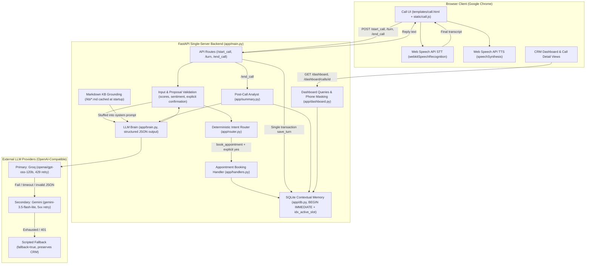
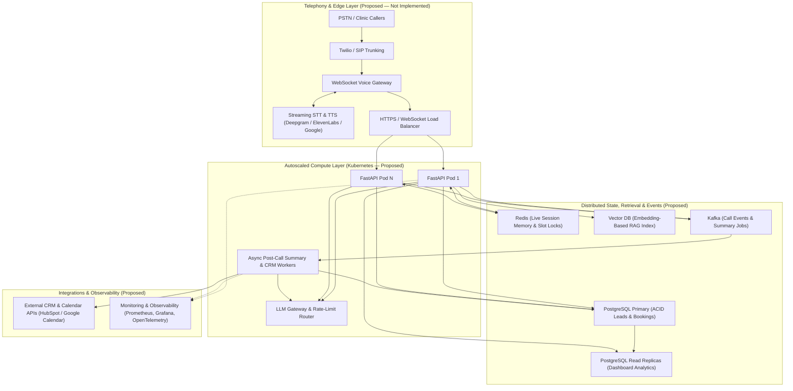

# Zenvo Architecture, Scalability & Production Design

This document describes the **implemented MVP** in this repository and contrasts it with a **proposed production architecture** for scaling to 100,000 registered clinics.

---

## 1. Implemented MVP Architecture

The current prototype runs as a single local FastAPI process serving Jinja2 HTML, static assets, and JSON endpoints backed by SQLite. Browser APIs simulate telephony audio.



**Responsibility split:**
- **Browser**: Captures speech via `webkitSpeechRecognition`, disables mic input while `speechSynthesis` speaks (with watchdog recovery), renders sanitized text transcripts via `textContent`, and falls back to a text input box if mic/TTS is unavailable.
- **Backend**: Owns all business rules, session state (`active` / `ended`, `pending_slot`), knowledge grounding, atomic SQLite transactions, PII masking, and LLM failover.

---

## 2. End-to-End Call Workflow

In every turn, the LLM returns a **proposal**; Python validates every field and executes state-changing actions only when deterministic checks pass.

```mermaid
sequenceDiagram
  actor Caller as Clinic Caller
  participant Browser as Browser UI (call.js)
  participant API as FastAPI (main.py)
  participant Brain as LLM Brain (brain.py)
  participant DB as SQLite (db.py)
  participant Analyst as Post-Call Analyst (summary.py)
  participant Dash as CRM Dashboard (dashboard.py)

  Caller->>Browser: 1. Click Start Call (phone, language)
  Browser->>API: POST /start_call
  API->>DB: 2. Find/create lead & retrieve returning context
  API-->>Browser: Greeting + returning_lead info

  Caller->>Browser: 3. Ask about Pro plan pricing
  Browser->>API: POST /turn (text)
  API->>Brain: 4. Generate KB-grounded JSON proposal
  Brain-->>API: reply (Rs 2,499), sentiment, lead_score, intent
  API->>DB: 5. Save turns & update score/sentiment in BEGIN IMMEDIATE
  API-->>Browser: Return reply, sentiment, lead_score

  Caller->>Browser: 6. Request demo slot (e.g. Friday 11:00 AM)
  Browser->>API: POST /turn
  API->>Brain: Propose free slot_datetime
  Note over API: LLM proposes action; Python validates and holds pending_slot (no insert yet)
  API->>DB: Set sessions.pending_slot = slot
  API-->>Browser: Ask caller to confirm slot

  Caller->>Browser: 7. Say "Yes, confirm that slot"
  Browser->>API: POST /turn
  API->>Brain: intent = book_appointment, slot_datetime
  Note over API: Python verifies slot == pending_slot AND explicit affirmative word tokens
  API->>DB: 8. BEGIN IMMEDIATE -> INSERT appointment (idx_active_slot) -> status='booked'
  API-->>Browser: Fixed localized confirmation template

  Caller->>Browser: 9. Hang up / click End Call
  Browser->>API: POST /end_call
  API->>Analyst: 10. Read transcript, generate analyst JSON, finalize_call()
  API-->>Browser: Summary, objections, buying signals, score

  Caller->>Dash: 11. Open GET /dashboard & /dashboard/calls/{id}
  Dash->>DB: Query KPIs, masked leads, appointments, transcript
  Dash-->>Caller: Server-rendered Jinja2 HTML
```

---

## 3. Proposed Production Architecture (Not Implemented)

The diagram below shows the **proposed production architecture** for multi-tenant telephony at scale. None of these distributed infrastructure components are implemented in the current repository.



---

## 4. Scalability Plan for 100,000 Users

> **Note:** No load testing at 100,000-user scale has been performed. The figures below are capacity estimates based on explicit traffic assumptions.

### Illustrative Scenario & Assumptions
- **Registered clinics/users**: `100,000`
- **Daily calls**: `10,000` calls/day (roughly 10% of registered accounts active per day)
- **Average call duration**: `5` minutes/call
- **Active business window**: `10` hours/day (`09:00–19:00` local clinic hours)
- **Peak burst factor**: `3x` the 10-hour business-day average during morning/evening clinic peaks
- **LLM calls per conversation**: `10` turns + `1` post-call summary = `11` LLM requests/call

### Traffic & Concurrency Calculations
- **Daily call minutes**: `10,000 calls × 5 min = 50,000 call minutes/day`
- **Average concurrent calls**:
  - Over 24 hours: `50,000 / 1,440 ≈ 34.7 concurrent calls`
  - Over the 10-hour business window: `50,000 / 600 ≈ 83.3 concurrent calls`
- **Estimated peak concurrent calls** (`3x` peak hour = `3,000 calls/hr`):
  - `(3,000 calls/hr × 5 min) / 60 min = 250 concurrent calls`
- **Daily LLM requests**: `10,000 × 11 = 110,000 requests/day`
- **Estimated peak LLM request volume**:
  - `(3,000 calls/hr × 11 requests/call) / 3,600 s ≈ 9.2 req/s` sustained during peak hour (~`550 req/min`), with short bursts of `15–20 req/s` as turns align.

Notice the distinction: **100,000 registered users** translates to roughly **250 simultaneous callers** at peak, not 100,000 concurrent connections.

### Why Each Production Component Is Needed
- **Horizontal scaling (Kubernetes + Load Balancer)**: A single Uvicorn process with blocking I/O cannot isolate noisy-neighbor audio streams or survive pod restarts during 250 concurrent WebSocket sessions.
- **Redis**: Replaces in-DB polling for hot turn history and provides short-lived distributed locks per clinic calendar slot across multiple FastAPI pods.
- **PostgreSQL + Read Replicas**: SQLite allows only one writer at a time (`BEGIN IMMEDIATE`), which creates lock contention at ~9–20 writes/s; PostgreSQL handles row-level concurrency and offloads dashboard aggregations to read replicas.
- **Kafka + Async Workers**: Decouples `/end_call` summary generation, CRM webhooks, and calendar sync from live voice latency so caller hang-ups never wait on analyst LLM calls.
- **Vector Retrieval (RAG)**: Prompt-stuffing 6 small Markdown files works for Zenvo's MVP KB, but multi-tenant clinic catalogs require embedding retrieval (`top-k` relevant chunks) to stay within token and latency budgets.
- **Provider Rate-Limit Management & Monitoring**: `550+ req/min` exceeds single free/low-tier provider buckets, requiring pooled API keys, adaptive backoff across Groq/Gemini/backup providers, and Prometheus/OpenTelemetry latency + 429/5xx alerting.

---

## 5. Security, Infrastructure and Cost

> **Important:** The current MVP has **no authentication** and must run **locally only (`127.0.0.1:8000`)**. Do not expose this prototype directly to the public internet.

### Implemented Security Controls (MVP)
1. **Environment-based credentials**: API keys live in `.env` (excluded via `.gitignore` and `tools/package_project.py`), never hardcoded in source or logs.
2. **Input validation**: Pydantic enforces `LANGS` (`en`, `hi`, `hinglish`), phone format (`[0-9+]{1,15}`), turn text length (`1–500` chars), and a `60`-turn cap per session.
3. **Structured LLM validation**: Rejects missing, boolean, string, `NaN`/`Inf` (`1e999`), or out-of-range scores and invalid sentiments before DB persistence.
4. **Parameterized SQL**: All queries in `app/db.py` and `app/dashboard.py` use `?` placeholders.
5. **Phone masking & PII stripping**: `app/dashboard.py` masks phone numbers before Jinja2 rendering; `app/brain.py` excludes `phone` and `email` from per-turn LLM prompts; parse errors never log raw model output.
6. **Safe DOM & template rendering**: `static/call.js` uses `textContent` (no user/LLM `innerHTML`), and Jinja2 autoescaping protects all dashboard templates.
7. **Atomic appointment booking**: Partial unique index `idx_active_slot` on `appointments(slot_datetime) WHERE status = 'confirmed'` inside `BEGIN IMMEDIATE` prevents double-booking.
8. **Explicit booking confirmation**: Deterministic word-token checks require explicit caller affirmation (`confirm`/`reject`/`ambiguous`) matching `pending_slot`.
9. **Restricted action execution**: `app/router.py` exposes only a small allowlisted handler dictionary (`book_appointment`) rather than arbitrary tool execution.
10. **Safe fallback behaviour**: On provider failure or malformed output, `fallback=true` returns a scripted message without overwriting lead score, sentiment, or CRM fields.

### Proposed Production Security Controls (Not Implemented)
1. **Authentication & RBAC**: OAuth2/JWT login with clinic admin vs sales agent permissions for `/dashboard` and APIs.
2. **OTP & caller verification**: Verify returning callers via OTP or trusted caller-ID matching before revealing saved clinic context.
3. **Encryption in transit and at rest**: Enforce TLS 1.3 at the ingress/load balancer and disk/column encryption (KMS + AES-256) for PostgreSQL and Redis.
4. **Secrets management**: Store provider keys in AWS Secrets Manager / GCP Secret Manager with rotation rather than `.env` files.
5. **Tenant isolation**: Enforce `clinic_id` row-level security so one clinic can never query another's leads or recordings.
6. **PII retention & redaction**: Automated retention expiry, transcript redaction pipelines, and opt-out enforcement.
7. **Rate limiting**: Per-IP and per-tenant token-bucket limits at the API gateway.
8. **Audit logging**: Immutable audit trail of all CRM reads, exports, and booking changes.
9. **Call recording consent**: Automated region-aware consent announcement before STT/recording starts.
10. **Prompt injection mitigation**: Input delimiters, strict schema enforcement, and separation between untrusted caller speech and privileged backend actions (extending the MVP's deterministic confirmation pattern).

### Cost Drivers & Parameterized Monthly Cost Formula
Primary production cost drivers are **telephony minutes** (PSTN/SIP), **streaming STT/TTS minutes**, **LLM input + output tokens** (system prompt + conversation turns + summary), **compute pods/workers**, and **PostgreSQL/Redis/log storage**.

Because provider pricing changes frequently, use this transparent parametric formula for `M = 10,000 calls/day × 30 days = 300,000 calls/month` (`1,500,000 call minutes/month`):

```text
Monthly_Cost =
    (Minutes_per_month * C_telephony)
  + (Minutes_per_month * C_stt_tts)
  + (Calls_per_month * Turns_per_call * (Tokens_in_turn * C_llm_in + Tokens_out_turn * C_llm_out))
  + (Calls_per_month * (Tokens_in_sum * C_llm_in + Tokens_out_sum * C_llm_out))
  + C_compute_and_db_monthly
```

Where:
- `Minutes_per_month = 300,000 * 5 = 1,500,000`
- `Turns_per_call = 10` (plus `1` summary call)
- `Tokens_in_turn` ≈ system prompt + KB context + last 10 turns (~1,500–2,500 tokens/turn with KB stuffing, or smaller with top-k RAG)
- `Tokens_out_turn` ≈ JSON reply + reasoning tokens (~100–300 tokens/turn)
- `C_telephony`, `C_stt_tts`, `C_llm_in`, `C_llm_out`, and `C_compute_and_db_monthly` are plugged in from your contracted vendor rates at deployment time.

---

## 6. Built vs Designed Comparison

| Capability | Implemented MVP (This Repo) | Proposed Production Extension (Designed Only) |
|---|---|---|
| **Voice Channel** | Browser Web Speech API (`webkitSpeechRecognition` + `speechSynthesis`) | Twilio / SIP telephony with streaming STT/TTS |
| **Interaction Model** | Turn-based HTTP `POST /turn` (pause mic while speaking) | Full-duplex WebSocket audio streaming with barge-in |
| **Session & Lead Memory** | Local SQLite (`zenvo.db`) with `BEGIN IMMEDIATE` transactions | Redis hot session state + PostgreSQL with read replicas |
| **Languages** | `en` (`en-IN`), `hi` (`hi-IN`), `hinglish` (`en-IN`); unsupported coerced safely | Configurable per-clinic locales with neural multilingual TTS |
| **Lead Scoring & Sentiment** | Per-turn LLM proposal validated (`0–100`, finite) + post-call analyst | Dedicated scoring calibration + async analytics pipeline |
| **Knowledge Grounding** | 6 Markdown files (`/kb/*.md`) concatenated and stuffed at startup | Embedding-based vector RAG over per-tenant documents |
| **Appointment Booking** | Two-step confirmation (`pending_slot` + token check) + SQLite `idx_active_slot` | Distributed Redis slot locks + live clinic calendar sync |
| **CRM Integration** | Local SQLite CRM (`leads`, `calls`, `appointments`) + Jinja2 dashboard | Bi-directional HubSpot / Salesforce / HMS webhooks via Kafka |
| **Call Summary & Insights** | Synchronous `POST /end_call` idempotent summary + fallback from lead table | Asynchronous Kafka worker queue with retry DLQ |
| **LLM Provider Failover** | Groq primary (`429` retry) -> Gemini secondary (`500/502/503/504` retry) -> scripted fallback | Multi-region LLM gateway with circuit breakers and pooled keys |
| **Infrastructure & Security** | Single local FastAPI process (`127.0.0.1`), unauthenticated, strict input/output guards | Kubernetes autoscaling, OAuth2/RBAC, WAF rate limits, KMS encryption, OpenTelemetry |
